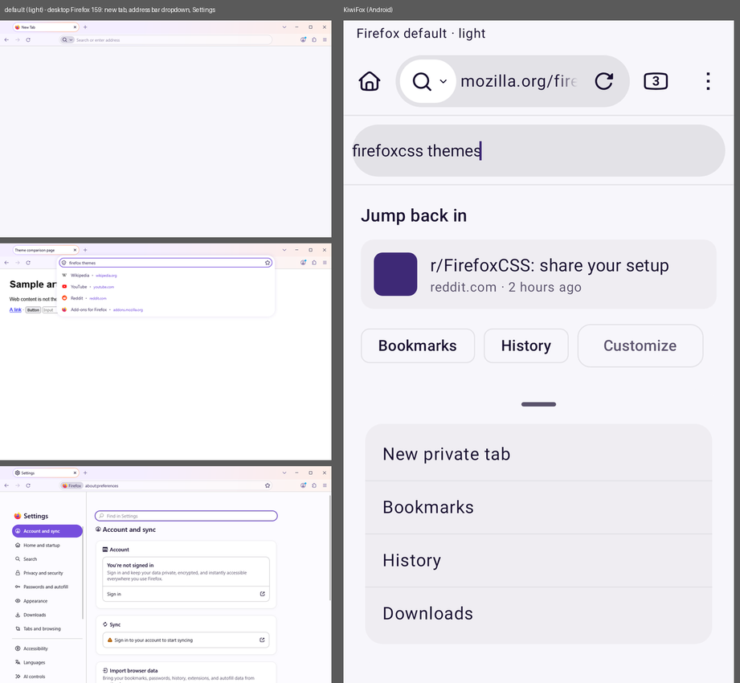
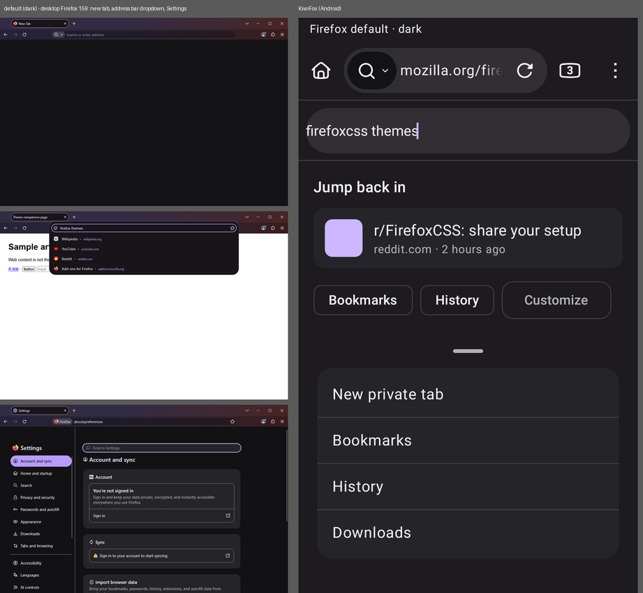
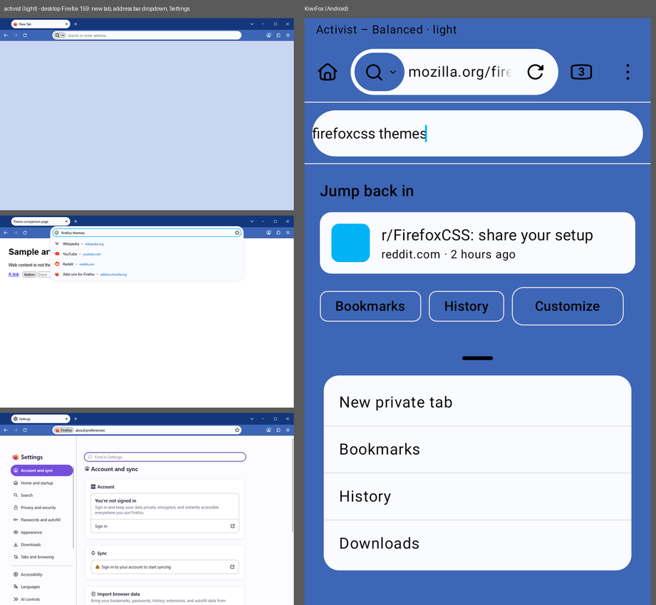
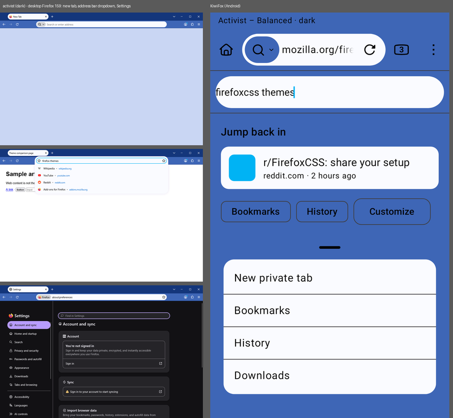
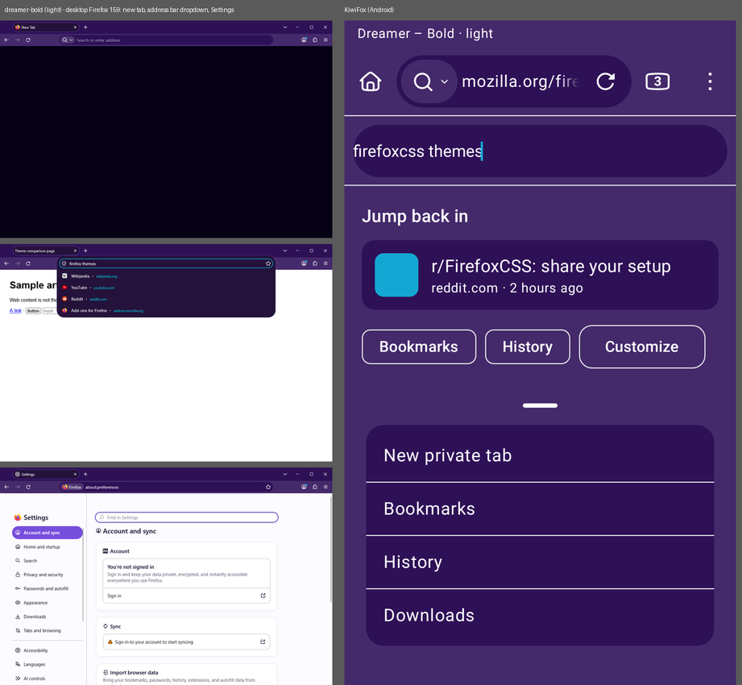
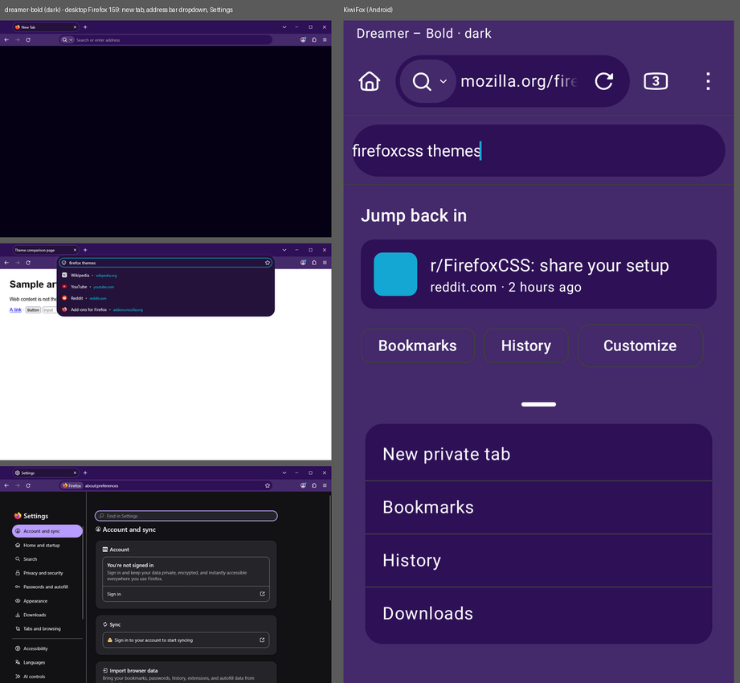
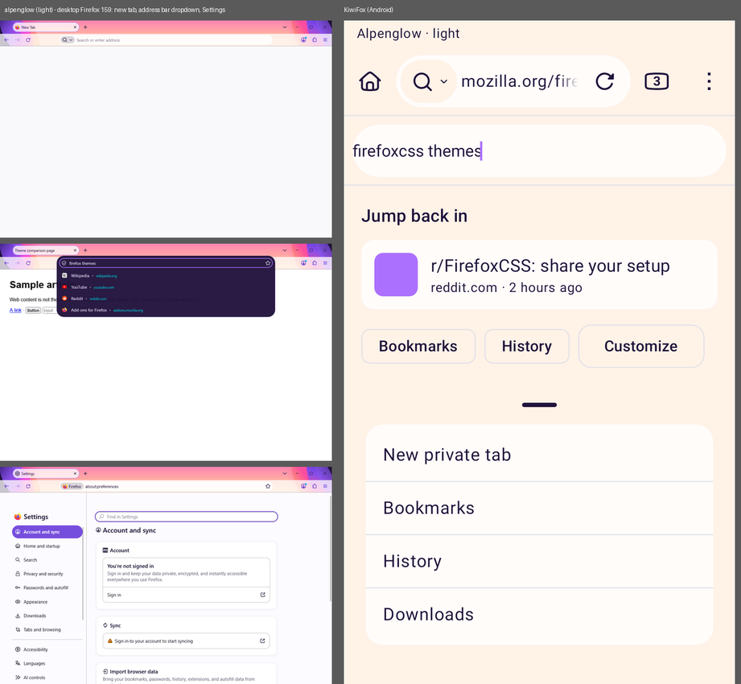
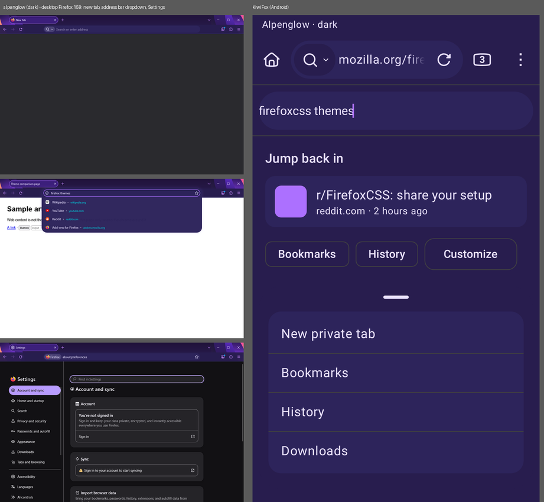
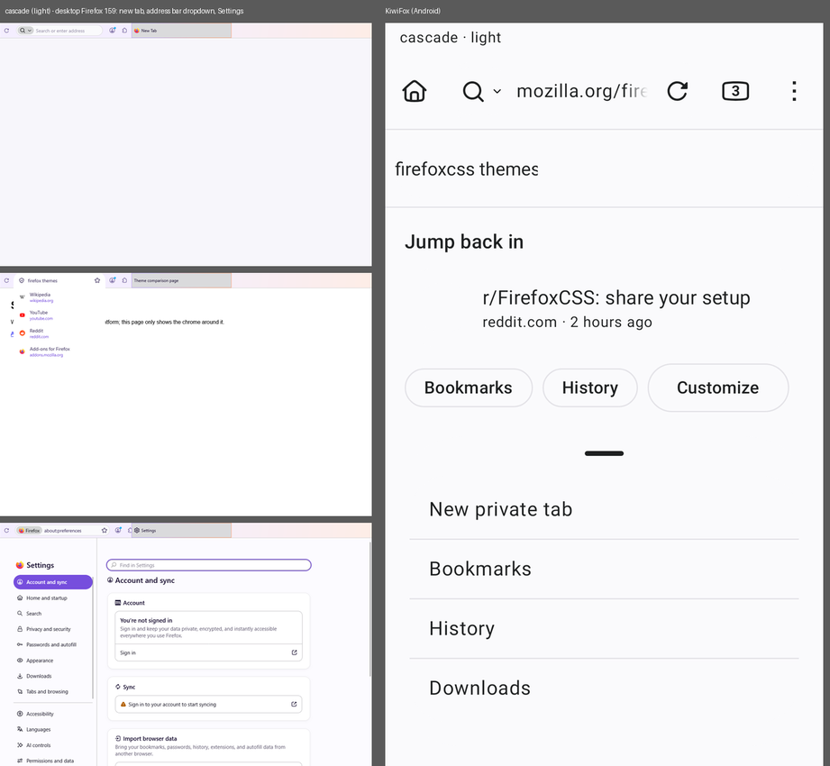
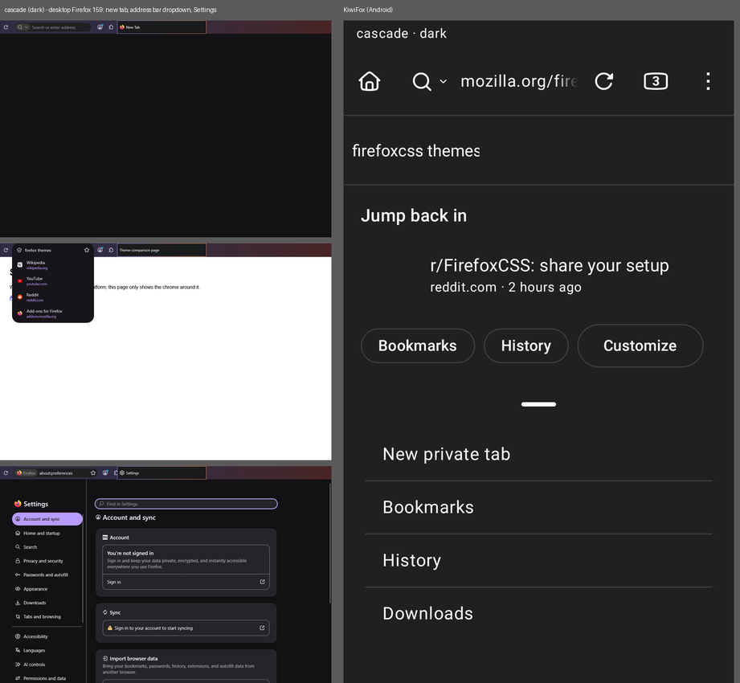

# Desktop Firefox vs KiwiFox: where theme mapping falls short

Compared 2026-11-10 on five themes, light and dark: stock Firefox, **Activist – Balanced** and
**Dreamer – Bold** (AMO), **Alpenglow** (Mozilla built-in, bundled in KiwiFox) and **Cascade**
(userChrome.css). Desktop is the installed Firefox 159.0.1 (the same release KiwiFox is built from),
driven headless by `tools/desktop_shots.py` with a throwaway profile; KiwiFox is the off-device
render from `screenshots.sh`. `tools/compare_sheets.py` puts them side by side.

Each sheet: desktop new tab, address bar dropdown ("prompt") and Settings on the left, KiwiFox
(toolbar, address bar in edit mode, home card and chips, main-menu sheet) on the right.

| Theme | Light | Dark |
|---|---|---|
| Firefox default |  |  |
| Activist – Balanced |  |  |
| Dreamer – Bold |  |  |
| Alpenglow |  |  |
| Cascade |  |  |

## Measured colors (dominant pixel color per region)

| Theme / mode | Desktop bar | Desktop field | **Desktop new tab** | **Desktop dropdown** | KiwiFox bar | KiwiFox field | **KiwiFox home** | **KiwiFox menu** |
|---|---|---|---|---|---|---|---|---|
| Activist light | #3E66B6 | #FAFBFF | **#C9D6F3** | #FAFBFF | #3E66B6 | #FAFBFF | **#3E66B6** | #FAFBFF |
| Dreamer – Bold | #44296B | #2E1056 | **#050014** | **#24123B** | #44296B | #2E1056 | **#44296B** | **#2E1056** |
| Alpenglow light | #FFF2E7 | #FFFCFA | **#F9F9FB** | **#291B43** | #FFF2E7 | #FFFCFA | **#FFF2E7** | **#FFFCFA** |
| Alpenglow dark | #271D4E | #2D245B | **#2A2A2E** | #31285E | #281D4E | #2D245B | **#281D4E** | #2D245B |
| Cascade light | #FAFAFC | #FAFAFC | #F7F6FB | #FFFFFF | #FAFAFC | #FAFAFC | #FAFAFC | #FAFAFC |
| Cascade dark | #1E2021 | #1E2021 | #131215 | #171519 | #1E2021 | #1E2021 | #1E2021 | #1E2021 |

**What already matches:** the toolbar and address field colors are identical to desktop for every
theme (after the import fix below), and so are text colors and the focus accent (Dreamer's cyan cursor).

## Gaps, by visual impact

1. **New tab / homepage background (`ntp_background`, `ntp_text`, `ntp_card_background`).** Desktop
   paints the new tab page in its own color: Activist pale blue #C9D6F3, Dreamer near-black #050014,
   Alpenglow #F9F9FB / #2A2A2E. KiwiFox drops these keys and paints the homepage with the toolbar
   color, so Activist's home is mid-blue and Dreamer's is purple instead of black. Biggest difference
   on screen. Map `ntp_background` -> the homepage background role, `ntp_text` -> its text,
   `ntp_card_background` -> card containers.
2. **Dropdowns and menus (`popup`, `popup_text`, `popup_highlight`, `popup_highlight_text`,
   `popup_border`).** Desktop uses these for the address-bar dropdown and every menu. Alpenglow light
   is the clearest case: a dark purple dropdown (#291B43) under a light toolbar, while KiwiFox's menu
   sheet and edit field stay light (#FFFCFA). Dreamer's dropdown is #24123B vs #2E1056 on mobile. The
   selected-suggestion highlight has no equivalent at all. Map `popup*` to the awesomebar (suggestion
   list) and the main-menu bottom sheet instead of reusing the field color.
3. **Two-tone header (`frame` vs `toolbar`).** Desktop shows `frame` in the tab strip above the
   toolbar (Activist #14367B navy over #3E66B6, Dreamer #2E1056 over #44296B). Android has no tab
   strip; KiwiFox uses only the toolbar color, also for the status bar. The status bar could take
   `frame` to keep the two-tone look.
4. **Focus ring (`toolbar_field_border_focus`).** Desktop draws this ring around the address bar
   while typing (Activist's cyan ring is visible in the dropdown shot). KiwiFox only draws a field
   border when the theme also sets `toolbar_field_border`, so AMO themes get no ring in edit mode.
5. **Toolbar icon color (`icons`, `icons_attention`).** Alpenglow dark tints toolbar icons violet
   (`icons` hsla(271,100%,77%)); KiwiFox paints icons with the URL text color.
6. **Header images (`additional_backgrounds`).** Alpenglow's pink-to-purple gradient (desktop frame
   #FF8AAF) is an image; Android has no image layer, so KiwiFox shows the flat toolbar color.
7. **Layout-only CSS.** Cascade's one-line layout (address bar left, tabs right) and tab styling have
   no Android equivalent. Its colors and 8 px corners do carry over.

**Not a gap:** desktop Settings (`about:preferences`) ignores the theme too and only follows
light/dark mode, so KiwiFox keeping Firefox's Settings colors for imported themes matches desktop.

## Bug found and fixed by this comparison

Cascade's light mode was dark on KiwiFox (#1E2021) while desktop showed #FAFAFC. The importer read
every `.css` file in a repository, and Cascade ships nine optional palettes in `integrations/`
(Catppuccin, Nord, Gruvbox, ...) that its `userChrome.css` never imports; the last one read won.
`CssBundler` now builds what desktop loads: `userChrome.css` with its `@import`s inlined in order,
with import media and `supports()` conditions kept. This also changed ArcWTF (its pill and 42 dp
height came from unimported files; it now gets 15 dp corners).

## Limits of this comparison

* Desktop menus open as separate popup layers that window screenshots do not include, so the app
  menu was not captured; its colors are the manifest's `popup*` values listed above.
* KiwiFox images are rendered off-device with the real toolbar code and theme, not from a phone,
  and do not include the suggestion list or tab tray, so `popup_highlight` and the tab keys
  (`tab_selected`, `tab_line`) are compared from data only.
* Web content is not themed on either platform.

Regenerate: `python tools/desktop_shots.py <dir> default=default activist=amo:<xpi> ...`, then
`screenshots.sh`, then `python tools/compare_sheets.py <desktop dir> <mobile dir> <out> <desktop>=<mobile> ...`.
